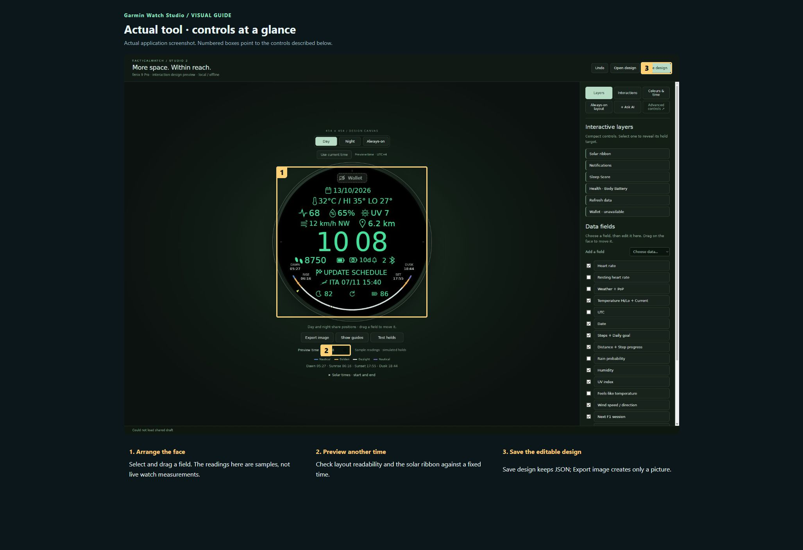
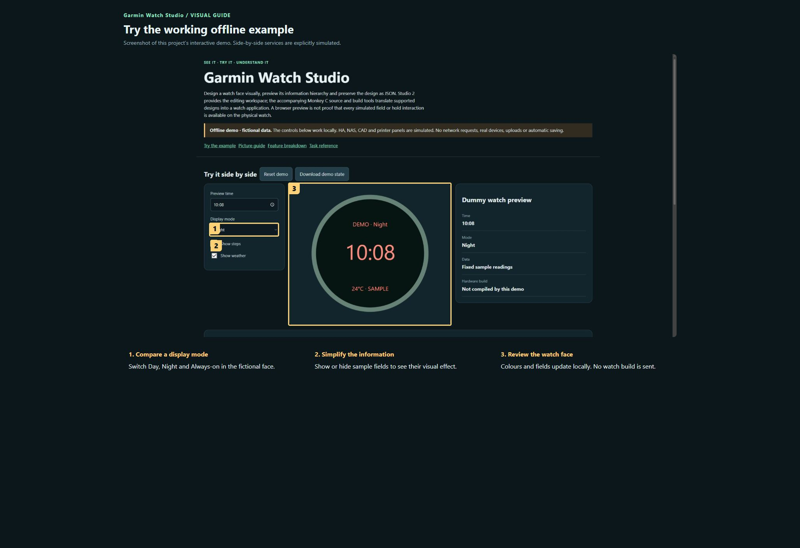

# Garmin Watch Studio — visual user manual

[Project overview](../README.md) · [Offline interactive demo](../demo.html)

Start with the numbered picture guide. Each number identifies the exact highlighted control. Work through one step at a time; the longer reference is below it.

### Actual tool · controls at a glance

Actual application screenshot. Numbered boxes point to the controls described below. 

1. **Arrange the face.** Select and drag a field. The readings here are samples, not live watch measurements.
2. **Preview another time.** Check layout readability and the solar ribbon against a fixed time.
3. **Save the editable design.** Save design keeps JSON; Export image creates only a picture.

### Try the working offline example

Screenshot of this project’s interactive demo. Side-by-side services are explicitly simulated.

1. **Compare a display mode.** Switch Day, Night and Always-on in the fictional face.
2. **Simplify the information.** Show or hide sample fields to see their visual effect.
3. **Review the watch face.** Colours and fields update locally. No watch build is sent.

## Detailed task reference

### Arrange a readable face

1. Open Watch-Face-Studio.html and choose Day. Use a fixed Preview time so changing time does not distract from spacing.
2. Choose a field in Layers or click it on the canvas. Drag it into position; Control/Command-click selects several and Alt-click selects underneath overlapping elements.
3. Use Add a field for another data item and Show guides for alignment. Hide unused fields rather than crowding the face.
4. Check Night and Always-on. Day and Night share positions, while the always-on layout needs its own readability review.

### Review interactions and sample data

1. Open Interactions and use Test holds to understand the intended press-and-hold targets. An unavailable Wallet label is a limitation, not a working launcher.
2. Compare a few preview times and read the solar ribbon. Sample heart rate, weather and sport fixtures are demonstration data.
3. Check the documented capability matrix before treating any field as live. Fields marked verify API require target-device verification.

### Save, build and compare

1. Save design as JSON, retain a named version and export an image for visual review. The image cannot reconstruct the editable design.
2. Use the existing design pipeline only with an explicitly selected design. Keep signing keys and the Garmin SDK outside this repository.
3. Compile both live and preview builds, capture the Garmin simulator and compare against the editor before installing on a watch.
4. Test actual readability, interactions and power use on hardware. Browser success alone is insufficient for a release.

## Keep your work

The offline editor uses JSON exports; the hosted editor can use a shared NAS draft. Generated watch assets, SDKs and signing credentials are deliberately not backed up here. A complete build needs a configured Garmin environment and an approved design.

## If something looks wrong

- Could not load shared draft in a local preview: use Open design for a local JSON or the authenticated hosted editor for NAS saving.
- Field works in preview but not on watch: check the capability matrix and target APIs.
- Changed design not in PRG: regenerate and compile the selected design rather than copying an older binary.

## What this manual does not promise

Target and API assumptions are recorded in the source README. No new simulator or physical-watch build was run in this documentation update. Public redistribution also needs a review of bundled assets and installation-specific references.

Screenshots show the actual application where captured. The offline demo is a deliberately smaller simulation and identifies its dummy services. It never controls devices, sends notifications, uploads files or launches printing.
